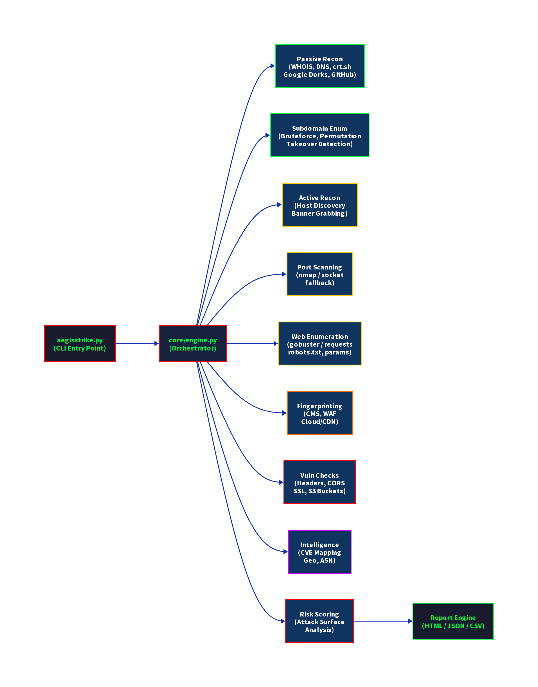
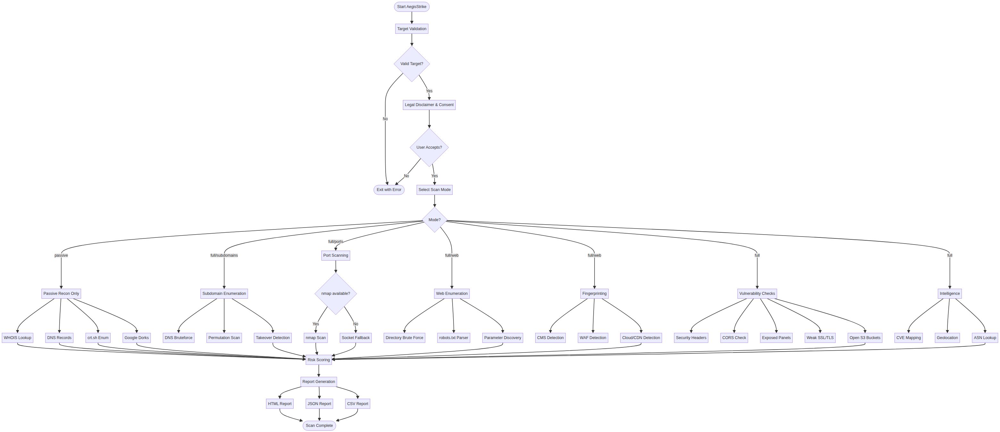

<div align="center">

```
    _    _____ ____ ___ ____ ____ _____ ____ ___ _  ________
   / \  | ____/ ___|_ _/ ___/ ___|_   _|  _ \_ _| |/ / ____|
  / _ \ |  _|| |  _ | |\___ \___ \ | | | |_) | || ' /|  _|
 / ___ \| |__| |_| || | ___) |__) || | |  _ <| || . \| |___
/_/   \_\_____|\_____\___|____/____/ |_| |_| \_\___|_|\_\_____|
```

**Elite Reconnaissance & Automated Pentesting Framework**


</div>

---

> ## ⚠️ LEGAL DISCLAIMER ⚠️
>
> **AegisStrike is designed for EDUCATIONAL PURPOSES and AUTHORIZED SECURITY TESTING ONLY.**
>
> By using this software, you agree to:
> - **ONLY** scan systems you own or have **explicit written permission** to test
> - Comply with all applicable laws and regulations in your jurisdiction
> - Accept **full responsibility** for your actions
> - **NOT** use this tool for illegal or unauthorized activities
> - **NOT** use passive recon data for malicious purposes
>
> **The authors assume NO LIABILITY for misuse, damage, or legal consequences resulting from the use of this software.**
>
> **USE RESPONSIBLY. STAY LEGAL. BE ETHICAL.**

---

## Quick Start

```bash
git clone https://github.com/yourusername/aegisstrike.git
cd aegisstrike
pip install -r requirements.txt

# Passive scan (no direct target contact)
python aegisstrike.py -t testphp.vulnweb.com --mode passive --report html

# Full scan
python aegisstrike.py -t testphp.vulnweb.com --mode full --report all

# Bug bounty mode
python aegisstrike.py -t example.com --mode bugbounty --report html -v
```

---

## Screenshots

> Screenshots will be available in [`docs/screenshots/`](docs/screenshots/) after running the tool.

| Screenshot | Description |
|---|---|
| `banner_startup.png` | AegisStrike banner and legal disclaimer on startup |
| `recon_in_progress.png` | Live reconnaissance with progress spinners |
| `findings_table.png` | Rich terminal findings summary table |
| `html_report.png` | Generated HTML report preview |

See [`docs/reports/sample_recon_report.html`](docs/reports/sample_recon_report.html) for a sample HTML report.

---

## Architecture





Full architecture documentation: [`docs/architecture/architecture.md`](docs/architecture/architecture.md)

---

## Demo Video

[Link to Demo Video](demo/demo_video_link.txt) — Add your demo video URL after recording.

---

## Features

| Feature | Description |
|---|---|
| **Passive Recon** | WHOIS, DNS records, crt.sh certificate transparency, Google dork generation |
| **Subdomain Enum** | DNS bruteforce, permutation scanning, takeover detection |
| **Active Recon** | Host discovery, banner grabbing |
| **Port Scanning** | nmap integration with socket-based fallback |
| **Web Enumeration** | Directory brute force (gobuster/requests), robots.txt, parameter discovery |
| **Fingerprinting** | CMS detection (WordPress, Joomla, Drupal), WAF detection, Cloud/CDN detection |
| **Vuln Checks** | Security headers, CORS misconfiguration, exposed admin panels, weak SSL/TLS, open S3 buckets |
| **CVE Mapping** | NVD API integration with fallback dataset |
| **Intelligence** | IP geolocation (ip-api.com), ASN lookup (bgpview.io) |
| **Risk Scoring** | Automated attack surface risk scoring and categorization |
| **Reporting** | Professional HTML, JSON, and CSV reports via Jinja2 |

---

## 🛠️ Installation

### Prerequisites
- **Python 3.10+**
- **Git**

### Setup & OS-Specific Instructions

#### 1. Clone the Repository
```bash
git clone https://github.com/Colly-dev/aegisstrike.git
cd aegisstrike
```

#### 2. Create and Activate Virtual Environment

| Operating System | Command |
| --- | --- |
| **Windows (CMD)** | `python -m venv venv` <br> `venv\Scripts\activate` |
| **Windows (PowerShell)** | `python -m venv venv` <br> `.\venv\Scripts\Activate.ps1` |
| **Linux / macOS** | `python3 -m venv venv` <br> `source venv/bin/activate` |

> **Note for Linux Users:** You might need to install `python3-venv` first if it's not present: `sudo apt install python3-venv`.

#### 3. Install Dependencies
Regardless of your OS, once the virtual environment is activated, run:
```bash
pip install -r requirements.txt
```

### Optional External Tools

AegisStrike falls back gracefully if these tools are not installed:

| Tool | Purpose | Fallback |
|---|---|---|
| `nmap` | Enhanced port scanning | Socket-based scanner |
| `gobuster` | Directory enumeration | requests-based brute forcer |
| `nuclei` | Template-based vuln scanning | Plugin disabled |

Install optional tools on Kali/Debian:
```bash
sudo apt install nmap gobuster
```

### Docker

```bash
docker-compose up --build
docker-compose run aegisstrike -t example.com --mode passive
```

---

## Usage

```
python aegisstrike.py [OPTIONS]

Options:
  -t, --target TEXT       Target domain, IP, or CIDR  [required]
  --mode TEXT             Scan mode [full|quick|web|subdomains|ports|bugbounty|passive]
  --report TEXT           Report format [html|json|csv|all|none]
  --threads INTEGER       Number of threads (default: 10)
  --timeout INTEGER       Timeout in seconds (default: 30)
  --wordlist PATH         Custom wordlist path
  -v, --verbose           Enable verbose output
  --no-active             Force passive-only mode
  --help                  Show this message and exit
```

### Scan Modes

| Mode | Description |
|---|---|
| `full` | All phases in sequence |
| `quick` | Fast scan of key indicators |
| `web` | Web enumeration and fingerprinting only |
| `subdomains` | Subdomain enumeration only |
| `ports` | Port scanning only |
| `bugbounty` | Bug bounty optimized workflow |
| `passive` | Passive recon only — no direct target contact |

---

## Project Structure

```
aegisstrike/
├── src/
│   ├── core/               # Engine, config, session, task management
│   ├── reconnaissance/     # Passive, active, subdomain modules
│   ├── enumeration/        # Ports, web, SSL, DNS
│   ├── fingerprinting/     # CMS, WAF, cloud detection
│   ├── vulnerability_checks/ # Headers, CORS, SSL, S3
│   ├── attack_surface/     # Risk scoring
│   ├── intelligence/       # CVE mapping, geolocation, ASN
│   ├── automation/         # Workflows (full recon, bug bounty)
│   ├── plugins/            # Nuclei, screenshot plugins
│   ├── cli/                # CLI arguments, interactive shell
│   └── utils/              # Logger, validators, rate limiter
├── tests/                  # Unit and integration tests
├── docs/                   # Screenshots, diagrams, reports
├── config/                 # config.yaml, settings.json
├── wordlists/              # Directories, subdomains, parameters
├── reports/                # Generated reports (html/json/csv)
├── aegisstrike.py          # Entry point
└── requirements.txt
```

---

## Testing

```bash
# Run all tests
pytest tests/ -v

# Run with coverage
pytest tests/ --cov=src --cov-report=html

# Run unit tests only
pytest tests/unit/ -v
```

---

## Configuration

Edit [`config/config.yaml`](config/config.yaml) to customize:
- Thread count and timeout
- Rate limiting
- Enable/disable individual modules
- Wordlist paths
- User-agent string

Environment variable overrides:
```bash
export AEGIS_THREADS=20
export AEGIS_TIMEOUT=60
export GITHUB_TOKEN=your_token_here
export NVD_API_KEY=your_nvd_key_here
```

---

## Contributing

1. Fork the repository
2. Create a feature branch: `git checkout -b feature/your-feature`
3. Commit your changes: `git commit -m 'Add your feature'`
4. Push to the branch: `git push origin feature/your-feature`
5. Open a Pull Request

---

## License

MIT License — see [LICENSE](LICENSE) for details.

**Additional Notice:** This software is intended for EDUCATIONAL PURPOSES and AUTHORIZED SECURITY TESTING ONLY. Users are solely responsible for ensuring they have proper authorization before scanning any systems.

---

<div align="center">
Made with ❤️ for the cybersecurity community &mdash; USE RESPONSIBLY
</div>
